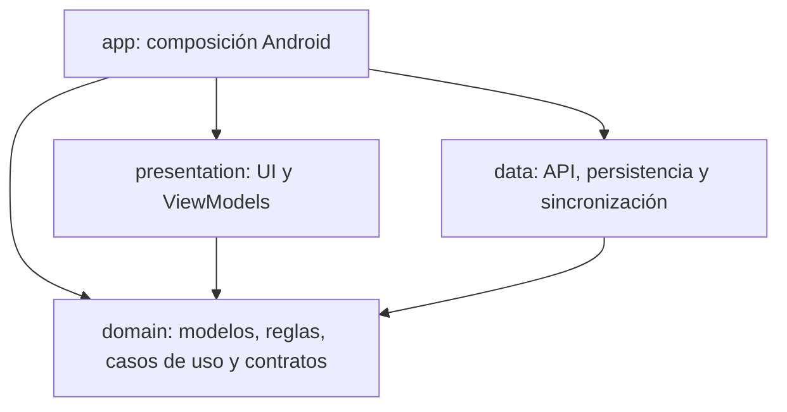

# Clean Architecture y Kotlin Multiplatform

La aplicación distribuible sigue siendo Android. Los cuatro módulos aplican
`org.jetbrains.kotlin.multiplatform`; las pantallas usan Compose Multiplatform.
El target JVM de `domain` sirve para comprobar las reglas compartidas sin el SDK
Android. No se entrega una aplicación de escritorio ni una aplicación iOS.

## Dependencias



`presentation` no depende de `data`. Los ViewModels reciben contratos del dominio
y observan `StateFlow`; no conocen Ktor, SQLDelight, DTO ni implementaciones de
repositorios. La composición de Koin vive en `app/src/androidMain` y conecta las
implementaciones con esos contratos. Los casos de uso existentes se conservan
en `domain/domain/usecase`; las funciones de validación académica y de reportes
también pertenecen al dominio.

## Módulos y source sets

| Módulo | `commonMain` | `androidMain` |
| --- | --- | --- |
| `domain` | Entidades, comandos, contratos de repositorio, validaciones, casos de uso y cálculos de reportes | Sin código de negocio específico de Android |
| `data` | DTO, mapeos explícitos al dominio, cliente Ktor con motor inyectado, repositorios, esquema SQLDelight y coordinación de la cola | Keystore, ContentResolver, WorkManager y adaptadores de políticas de conexión/URL |
| `presentation` | Pantallas Compose, navegación, tema, ViewModels y contratos de servicios de plataforma | Cámara, selector de archivos, decodificación de imágenes, impresión/PDF, compartir, previews y formato nativo |
| `app` | Sin pantallas ni reglas de negocio | Application, Activity, enlace SSO, Koin, manifiesto y recursos de Android |

Los datos de transporte permanecen en `data`: por ejemplo `StudentDto` se
convierte explícitamente a `Student`, y `UpdateRecordCommand` se convierte a
`UpdateRecordRequest` antes del envío. Los modelos del dominio no contienen
anotaciones de serialización ni dependencias de frameworks de infraestructura.
Los mapeos conservan los campos opcionales, las colecciones anidadas y las
cadenas vacías usadas para limpiar campos en la API.

## Funciones específicas de Android

KMP comparte el código portable; las APIs del sistema necesitan adaptadores.
`expect/actual` delimita el contexto de plataforma, captura, selección y
decodificación de imágenes, impresión y compartición. Los contratos
`ReceiptImageReader`, `AcademicExportManager`, `SyncScheduler` y `ErrorMessages`
permiten inyectar servicios sin acoplar los consumidores a su implementación.

El motor HTTP se proporciona al construir `ApiClient`. Android usa el motor
Android de Ktor. El almacenamiento de sesión conserva Android Keystore y la
base local conserva el nombre, esquema y migraciones originales. Se mantienen
FileProvider, `FLAG_SECURE`, el control de propietario de los borradores y la
prohibición de reintentar automáticamente envíos de resultado ambiguo.

Agregar otro sistema operativo exige declarar su target e implementar estos
adaptadores. Esta migración no afirma que exista una app iOS ni que el código
nativo de Android pueda ejecutarse sin cambios en iOS.

## Comprobaciones

Desde la raíz del proyecto, con Java 17 y Android SDK 34:

```powershell
.\gradlew.bat verifyArchitecture :domain:jvmTest :domain:testDebugUnitTest :data:testDebugUnitTest :presentation:testDebugUnitTest :app:testDebugUnitTest :app:assembleDebug
.\gradlew.bat :app:lintDebug :app:assembleRelease :app:assembleDebugAndroidTest
# Emulador o dispositivo autorizado conectado:
.\gradlew.bat :app:connectedDebugAndroidTest
```

`verifyArchitecture` rechaza imports de Android/Java en `commonMain`, acceso a
infraestructura desde el dominio y referencias a `data` o Ktor desde la
presentación. También comprueba que presentación no declare una dependencia
Gradle de datos. CI ejecuta esta comprobación junto con las pruebas por módulo.

Las 107 pruebas unitarias anteriores se conservan, distribuidas entre sus
módulos propietarios. Se añadieron pruebas de traducción DTO/dominio y de fechas
y formato numérico portable. Las pruebas comunes del dominio se ejecutan en
JVM y Android; son las mismas pruebas en dos targets, no casos únicos extra.

Las pruebas instrumentadas de catálogos usan repositorios simulados y no
escriben en producción. La integración autenticada con el servidor, la cámara
física y una impresora real siguen necesitando una cuenta y dispositivos de
prueba autorizados.

### Validación local del 29 de octubre de 2026

- `verifyArchitecture`: correcto.
- 113 casos unitarios únicos aprobados; los 16 del dominio también aprobados
  en JVM (129 ejecuciones en total).
- 5 pruebas instrumentadas aprobadas en Android 14, sin fallos ni omisiones.
- APK debug y release compilados; release sin firma de distribución.
- Lint: 0 errores y 45 advertencias de versiones/configuración de dependencias.
- APK debug instalado y `MainActivity` iniciada correctamente en el emulador.
